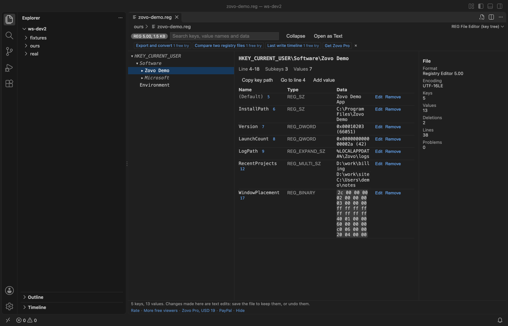

# REG File Editor & Hive Viewer

Open Windows .reg files in VS Code as a key tree with every value decoded, edit them there or as colored text, and browse binary registry hives (NTUSER.DAT, SYSTEM, SOFTWARE) read-only. Made by Zovo.

Free, with no account and no network calls:

- Opens .reg files (Registry Editor 5.00 in UTF-16 or UTF-8, and REGEDIT4) as a key tree with a value table. Every type is decoded: strings, DWORD and QWORD as hex and decimal, expandable strings and multi-strings from their hex(2) and hex(7) bytes, and binary data as hex.
- Edit, add or remove a value in the table. The change goes into the text as a normal edit, so Undo and Save work as usual.
- Syntax colors for .reg text, and every line that cannot be read is marked in the editor and listed in the Problems panel as you type.
- Opens registry hives read-only by their "regf" header: right-click NTUSER.DAT, UsrClass.dat, SYSTEM, SOFTWARE, SAM or any other hive and pick Open as Registry Hive (.hiv files open directly). Browse keys, values, last write times and class names.
- Search key names, value names and value data in .reg files and hives.
- Hives that were not closed cleanly open as they are on disk, with a note that the transaction logs are not applied.
- Nothing is ever written to the live Windows registry, and no other program runs. It works the same on Windows, macOS and Linux.

Zovo Pro: USD 19 once, for the Pro tools in every Zovo extension. Each Pro tool has 1 free try on your computer first:

- Export and convert: save a hive, a .reg file or one key as .reg (version 5.00 or REGEDIT4), JSON or CSV, and convert .reg files between REGEDIT4 and 5.00.
- Compare two registry files: two .reg files or two hives (before and after an install), key by key and value by value. Save a .reg patch that turns A into B, and a Markdown report.
- Last write timeline: every key of a hive sorted by its last write time, newest first, with a date and key filter. Save it as CSV.

## How to use it

- Click a .reg file. It opens in the key tree. Open as Text (in the toolbar or the editor title bar) puts the text beside it, and the tree follows your typing.
- Click a key to see its values. Edit, Remove and Add value change the text; save the file to keep the change. The small line number next to a value name jumps to its line.
- For a hive, right-click the file in the Explorer and pick Open as Registry Hive, or run Registry: Open as Registry Hive from the Command Palette. Files with no "regf" header get a short note and no tab opens.
- Type in the search box to find keys, value names and data. Click a match to go to its key.
- To try it without your own files, run Registry: Open the Sample .reg File or Registry: Open the Sample Hive from the Command Palette. The .reg sample opens as a copy, so editing it changes nothing in the extension.
- The Pro tools are in the Command Palette (Registry: ... (Pro)), in the Explorer right-click menu, in the viewer's title bar menu and in the small row at the end of the viewer toolbar. The row closes with its x for the rest of the session, and the setting `regEditor.showProTools` hides the Pro tools for good.

## What the viewer shows

A .reg file lists changes to import, so the tree shows what the file says: keys with a section of their own, the parent keys above them (in italics), keys the file deletes (`[-HKEY_...]`, struck through) and values it deletes (`"Name"=-`). A value written twice in one key shows its last value, as an import would set it.

A REGEDIT4 file saved in Windows-1252 that VS Code opens as UTF-8 shows correctly in the tree, read-only, with a note; reopen its text with the Windows 1252 encoding to edit it.

A hive is read straight from its cells. Big values stored in several segments are joined, and damaged cells are listed in a note while the rest of the hive stays readable. .dat files are not claimed as a whole: only Open as Registry Hive opens one, so other programs' .dat files keep their own editor.

## Privacy

The extension reads the file you open and nothing else. It makes no network calls, and nothing is uploaded or measured. Edits go only into the .reg file you edit, and the Pro tools write only the files you ask for. The links at the bottom of the viewer (Rate, More free tools, Zovo Pro) open a page only when you click them, and the setting `regEditor.showSupportLinks` hides them.

## Settings

| Setting | Default | What it does |
|---|---|---|
| `regEditor.showProTools` | true | Shows the Pro tools in menus, the palette and the toolbar row. |
| `regEditor.showSupportLinks` | true | Shows the Rate, More free tools and Zovo Pro links. |
| `regEditor.askForRating` | true | Asks once for a rating after two good uses at least 30 minutes apart. |

## Zovo Pro

One payment of USD 19 unlocks the Pro tools in every Zovo extension on your computers; a team of 5 is USD 59. The key works offline. Run Zovo Pro: Get Zovo Pro from the Command Palette. The Zovo Pro tab lists this extension's Pro tools and your free tries before any payment page opens.
